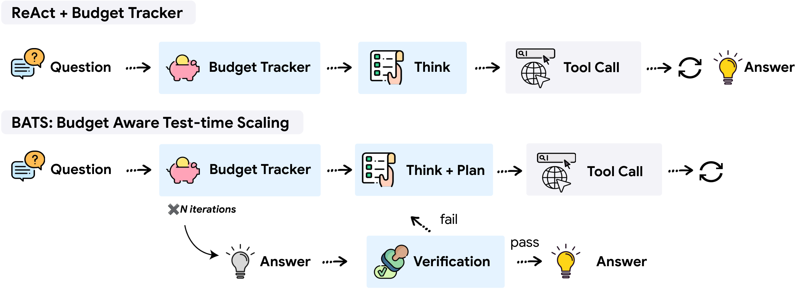

# Budget-Aware Tool-Use Enables Effective Agent Scaling

[[📄 Paper](https://arxiv.org/abs/2511.17006)]

<p align="center">
  
</p>

## 📜 Overview

Scaling test-time computation for tool-augmented agents plateaus when the agent has no awareness of its resource constraints. This repository releases the code for our paper: a **Budget Tracker** that gives the agent continuous awareness of its remaining tool-call budget, and **BATS** (Budget-Aware Test-time Scaling), a framework that dynamically decides — based on remaining budget — whether to keep pursuing a promising lead or pivot to a new direction. Together they yield better cost-performance scaling on deep-research benchmarks (BrowseComp, BrowseComp-ZH, HLE) under a unified cost metric covering both token and tool consumption.

The release contains three agent configurations:

- **`agent_react.py`** — ReAct-style baseline with search + browse tools, no budget awareness
- **`agent_budget_tracker.py`** — the baseline plus Budget Tracker: tracked, in-context budget status at every step
- **`agent_bats.py`** — BATS: budget-aware planning with self-verification, intermediate summarization, and hybrid test-time scaling

## 📁 Project Structure

```
budget-aware-agent/
├── data/                   # Dataset manifests (no benchmark content — see Datasets)
│   ├── bczh/bczh289_manifest.json      # question hashes + topics (289 questions)
│   ├── browsecomp/bc200_uids.json      # uids of the 200-question subset
│   └── hle/hle200_manifest.json        # question hashes (200 questions)
│
├── src/
│   ├── agent_react.py              # Baseline ReAct agent
│   ├── agent_budget_tracker.py     # Budget Tracker agent
│   ├── agent_bats.py               # BATS agent (main)
│   ├── prompts_react.py            # Prompts for each agent
│   ├── prompts_budget_tracker.py
│   ├── prompts_bats.py
│   ├── tool_google_search.py       # Google Search tool (SQLite cache)
│   ├── tool_browse.py              # Web browsing tool (Jina / crawl4ai, SQLite cache)
│   ├── evaluate.py                 # Stage-1 evaluation: LLM judge vs. gold answer
│   ├── select_answer.py            # Stage-2: model-based answer selection (BATS)
│   ├── analyze.py                  # Token / cost / budget-utilization analysis
│   └── helpers.py
│
├── scripts/
│   ├── prepare_data.py             # Download/decrypt benchmark data (run first)
│   ├── run_react.sh                # Paper configuration for each agent
│   ├── run_budget_tracker.sh
│   └── run_bats.sh
│
└── outputs/                # Results and caches (generated, gitignored)
```

## 🚀 Getting Started

### 1. Installation

```bash
conda create -n bats python=3.11 && conda activate bats   # or python -m venv .venv
pip install -r requirements.txt
```

### 2. Configuration

Copy `env.example` to `.env` in the repository root and fill in your keys:

```bash
# LLM access — set the key for the provider(s) you use. All model calls go
# through LiteLLM, so any supported provider works via its model prefix:
#   anthropic/claude-sonnet-4-5  -> ANTHROPIC_API_KEY
#   gemini/gemini-2.5-flash      -> GEMINI_API_KEY (Google AI Studio)
#   openai/gpt-5                 -> OPENAI_API_KEY
#   vertex_ai/gemini-2.5-pro     -> no key; `gcloud auth application-default login`
ANTHROPIC_API_KEY=your_anthropic_api_key
#GEMINI_API_KEY=your_gemini_api_key
#OPENAI_API_KEY=your_openai_api_key

# Web search (required) — pick one backend:
#  - serper.dev:
SEARCH_BACKEND=serper
SERPER_API_KEY=your_serper_api_key
#  - or Google Custom Search (the paper setting; default backend when
#    SEARCH_BACKEND is unset):
#CSE_ID=your_search_engine_id
#CSE_API_KEYS=your_api_key     # one or more keys, comma-separated; extras rotate on rate limits

# Browsing (optional)
JINA_API_KEY=your_jina_api_key # if unset, pages are fetched with crawl4ai instead
```

### 3. Prepare the datasets

Benchmark data is not shipped with this repository (see [Datasets](#-datasets)):

```bash
python scripts/prepare_data.py browsecomp
```

## 🏃 Running the Agents

Model calls are provider-agnostic via [LiteLLM](https://github.com/BerriAI/litellm): pass any supported model as `--model` with its provider prefix (`gemini/gemini-2.5-pro`, `anthropic/claude-sonnet-4-5`, `openai/gpt-5`, `vertex_ai/gemini-2.5-pro`, ...). The `scripts/run_*.sh` scripts contain the configuration used in the paper (`gemini/gemini-2.5-pro`, search/browse budgets of 100, BrowseComp-200):

```bash
bash scripts/run_react.sh            # baseline
bash scripts/run_budget_tracker.sh   # + Budget Tracker
bash scripts/run_bats.sh             # BATS
```

All agents share the same interface; a manual run looks like:

```bash
python src/agent_bats.py \
    --model gemini/gemini-2.5-flash \
    --search_budget 20 --browse_budget 20 \
    --begin 0 --end -1 \
    --temperature 0.7 --concurrency 15 \
    --tag my_experiment \
    --do_eval \
    --flag_optimize_query --flag_browse_flash --flag_gemini_no_think \
    --flag_remove_tool_responses --flag_cont_gen \
    --none_ans_threshold 5 --n_query_results 10 --sum_frequency 10 \
    --data_path data/browsecomp/bc200.jsonl \
    --seed 10
```

### Key parameters

| Parameter | Description | Default |
|-----------|-------------|---------|
| `--model` | LiteLLM model name (any provider) | `gemini/gemini-2.5-flash` |
| `--search_budget` / `--browse_budget` | Max search queries / URLs to browse | `10` |
| `--begin` / `--end` | Question index range (`-1` = all) | `0` / `1` |
| `--temperature` | Sampling temperature | `0.7` |
| `--concurrency` | Parallel processes | `20` |
| `--data_path` | Path to dataset JSONL (required) | — |
| `--search_backend` | Web search backend: `cse` (paper) or `serper` | `cse` |
| `--do_eval` | Run stage-1 evaluation after inference | off |
| `--wandb` / `--wandb_project` | Opt-in Weights & Biases logging | off |

### BATS-specific flags

- `--flag_cont_gen`: hybrid test-time scaling — start a new trajectory after a verified SUCCESS while budget remains (used in the paper)
- `--flag_optimize_query`: query optimization
- `--flag_browse_flash`: use the cheaper `--browse_model` (default `gemini/gemini-2.5-flash`) for page summaries
- `--flag_gemini_no_think`: disable thinking mode
- `--flag_remove_tool_responses`: compress old tool responses in the conversation
- `--sum_frequency`: rounds between intermediate summarizations (default `10`)

## 📊 Datasets

The experiments use three benchmarks:

- **BrowseComp** — `data/browsecomp/bc1266.jsonl` (full, 1266 questions) and `bc200.jsonl` (the 200-question subset used in the paper)
- **HLE** (Humanity's Last Exam) — `data/hle/hle200.jsonl` (200 questions)
- **BrowseComp-ZH** — `data/bczh/bczh289.jsonl` (289 questions)

**We do not redistribute benchmark questions or answers.** BrowseComp and BrowseComp-ZH are officially released in *encrypted* form so that answers do not end up in web crawls and contaminate future training data, and we keep it that way. This repository ships only subset manifests: `bc200_uids.json` (row indices) and SHA-256 hash manifests for HLE and BrowseComp-ZH (for exact subset selection and version verification). `scripts/prepare_data.py` rebuilds the JSONL files locally (they are gitignored).

### BrowseComp (fully automated)

```bash
python scripts/prepare_data.py browsecomp
```

This downloads the official encrypted test set from OpenAI's
[simple-evals](https://github.com/openai/simple-evals) storage, decrypts it, and writes
`bc1266.jsonl` and `bc200.jsonl`.

**How the decryption works** (implemented in `scripts/prepare_data.py`): each CSV row has
base64-encoded `problem` and `answer` ciphertexts plus a per-row `canary` string that serves
as the password. The key is the SHA-256 digest of the canary, repeated to the ciphertext
length, and the plaintext is the byte-wise XOR of the decoded ciphertext with that key:

```python
def derive_key(password: str, length: int) -> bytes:
    key = hashlib.sha256(password.encode()).digest()
    return key * (length // len(key)) + key[: length % len(key)]

def decrypt(ciphertext_b64: str, password: str) -> str:
    encrypted = base64.b64decode(ciphertext_b64)
    key = derive_key(password, len(encrypted))
    return bytes(a ^ b for a, b in zip(encrypted, key)).decode()
```

### HLE

HLE is gated on Hugging Face. Accept the terms at
[huggingface.co/datasets/cais/hle](https://huggingface.co/datasets/cais/hle), run
`huggingface-cli login`, then:

```bash
python scripts/prepare_data.py hle
```

The script selects our 200-question subset by matching question hashes against the manifest.

### BrowseComp-ZH

Obtain the dataset from the official
[BrowseComp-ZH repository](https://github.com/PALIN2018/BrowseComp-ZH) (distributed encrypted
with the same canary scheme; follow their instructions), then:

```bash
python scripts/prepare_data.py bczh --input /path/to/browsecomp_zh.jsonl
```

The `--input` file may be JSONL or CSV, decrypted or still canary-encrypted (the script
decrypts automatically when a `canary` field is present).

Each generated entry has the form `{"uid": ..., "problem": ..., "answer": ...}`.

## 📈 Evaluation

Evaluation is two-stage:

**Stage 1 — final-answer scoring.** Run with `--do_eval` (or `src/evaluate.py -d <results.jsonl>`):
an LLM judge compares each question's final answer against the gold answer and writes
`*_evalv1.jsonl`.

**Stage 2 — answer selection (BATS).** A BATS run produces multiple verified answers per
question (`all_sampling_stat`). The selection stage scores every intermediate answer, then a
judge model (`gemini/gemini-2.5-flash` by default; override with `--model` or the
`JUDGE_MODEL` env var for the scoring judge) picks the best candidate from the answers and their
self-verifications:

```bash
python src/select_answer.py -d outputs/agent_bats/<model>/<tag>/<run>_evalv1.jsonl
```

This writes `*_select.jsonl` and prints three metrics:

- **pass acc** — at least one candidate answer is correct (upper bound)
- **select acc** — the judge-selected answer is correct (the headline BATS metric reported in the paper)
- **first ans acc** — the first candidate answer is correct

Results are saved to `outputs/{agent_name}/{model}/{tag}/`; each entry records the full
reasoning trajectory, per-stage token counts, and budget usage. `src/analyze.py` computes
token/cost statistics and budget-utilization summaries from these files.

## 📚 Citation

If you find our work helpful, please kindly consider citing:

```bibtex
@inproceedings{liu2026budget,
  title={Budget-Aware Tool-Use Enables Effective Agent Scaling},
  author={Liu, Tengxiao and Wang, Zifeng and Miao, Jin and Hsu, I-Hung and Yan, Jun and Chen, Jiefeng and Han, Rujun and Xu, Fangyuan and Chen, Yanfei and Jiang, Ke and Daruki, Samira and Liang, Yi and Wang, William Yang and Pfister, Tomas and Lee, Chen-Yu},
  booktitle={Third Conference on Language Modeling},
  year={2026},
  url={https://arxiv.org/abs/2511.17006}
}
```

This is not an officially supported Google product. This project is not eligible for the
[Google Open Source Software Vulnerability Rewards Program](https://bughunters.google.com/open-source-security).
